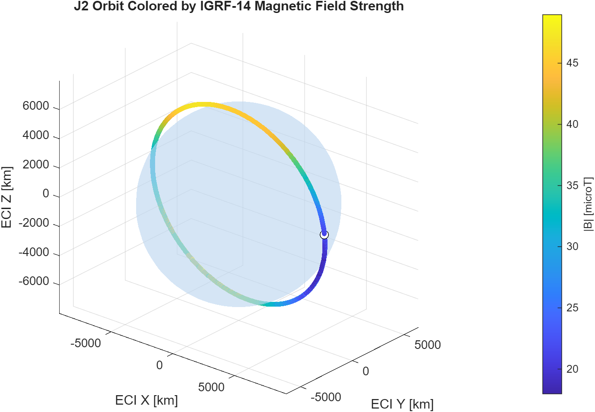
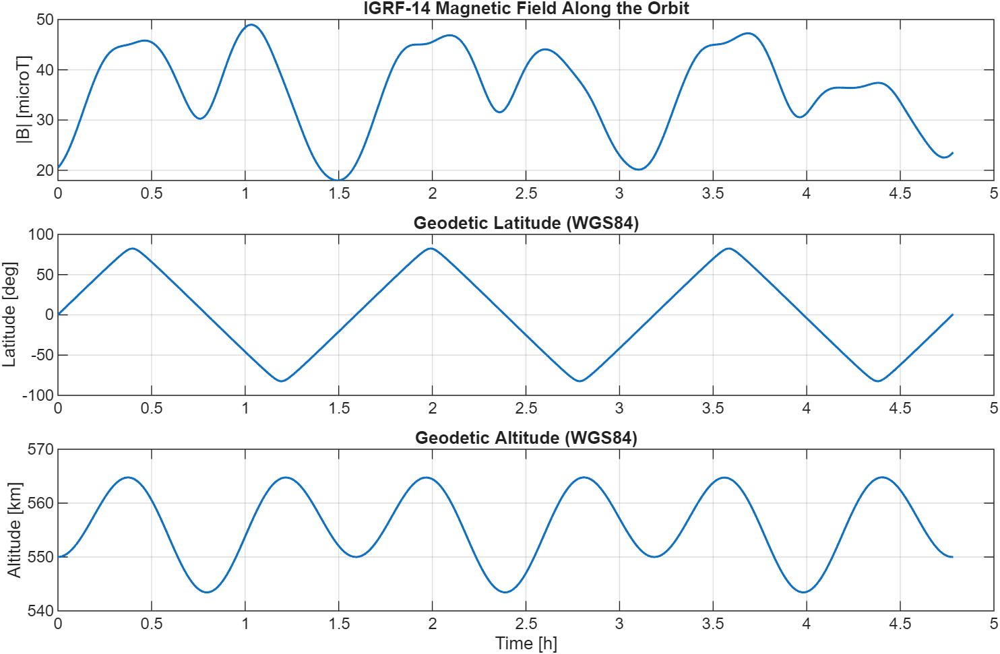
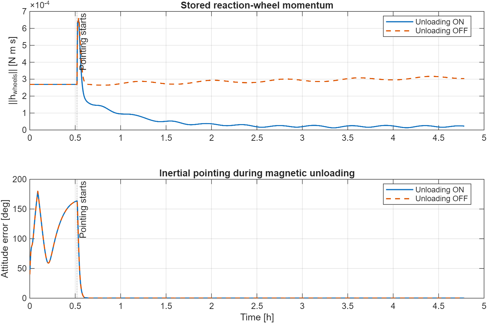
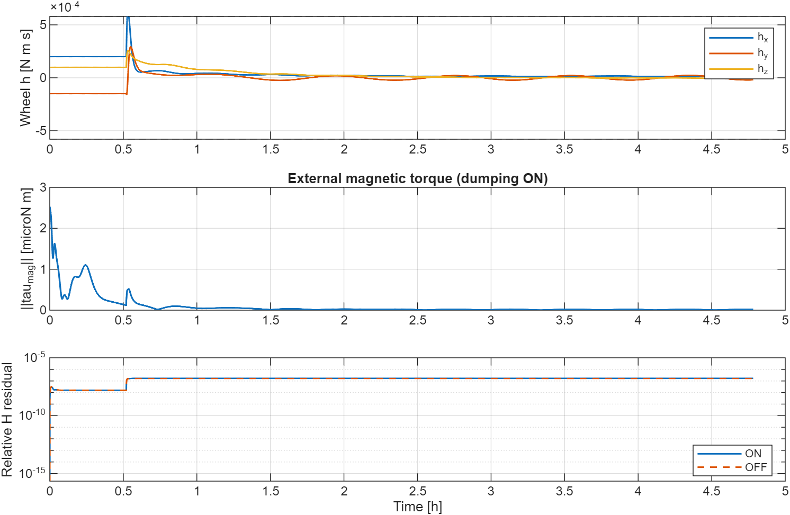
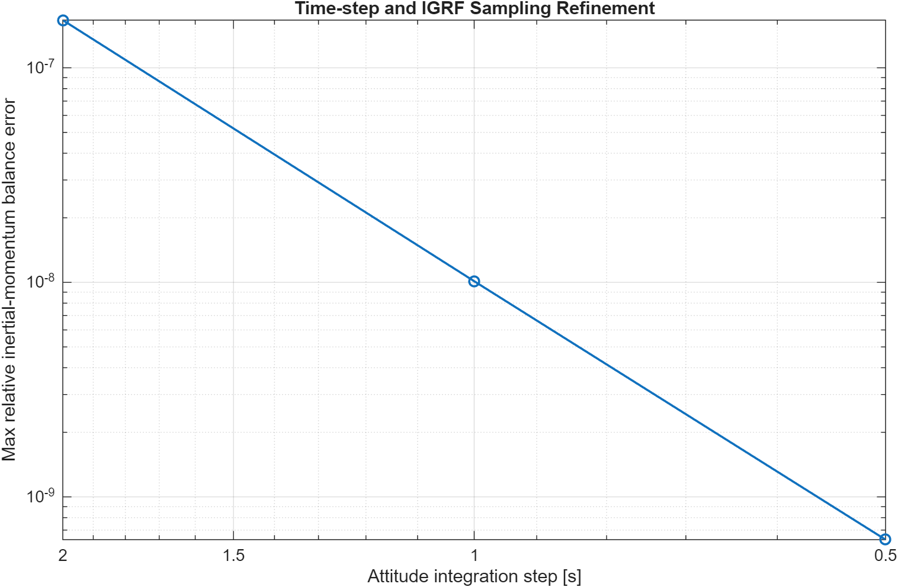
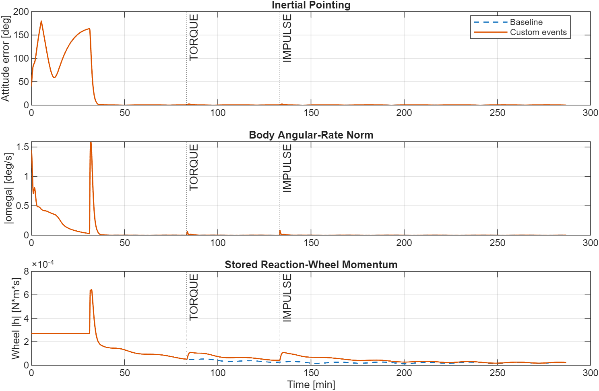
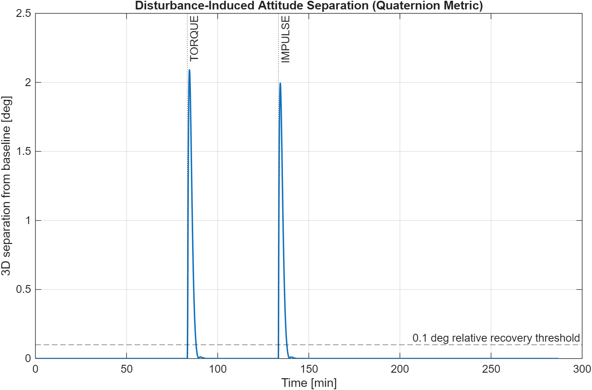

# CubeSat Orbital Dynamics & Three-Axis Attitude Control

**MATLAB R2025b | Aerospace Toolbox | Physics-based virtual 3U CubeSat**

A reproducible MATLAB simulation of three-axis spacecraft attitude dynamics along a J2-perturbed low-Earth orbit. The virtual CubeSat combines **three orthogonal reaction wheels** for inertial pointing with **three magnetic torque rods** for detumbling and reaction-wheel momentum unloading. The external geomagnetic environment is evaluated using **IGRF-14**, not a spatially uniform field.

**Scope:** a research/educational *attitude-control* simulator using ideal state feedback and representative published hardware parameters. It is **not** flight software, a flight-data reconstruction, a verified electrical design, a Tigrisat digital twin, or a full sensor-based attitude-determination system.

## Quick start

Requires **MATLAB R2025b** with **Aerospace Toolbox** installed, particularly `igrfmagm`, `dcmeci2ecef`, `ecef2lla`, and `dcmecef2ned`. The code uses MATLAB scripts and functions; **Simulink is not required**.

1. Download/clone the repository and open its root folder in MATLAB **Current Folder**.
2. Run the numerical tests first:

   ```matlab
   run_tests
   ```

3. Generate the orbital plots and the demonstrations:

   ```matlab
   run_environment_demo
   run_demo
   run_convergence
   run_disturbance_demo
   ```

Only the top-level `run_*.m` scripts are executed directly. They add `config/` and `src/` to the MATLAB search path, run the required functions, and save reproducible figures as PNG files in `figures/`. Run times depend on the system and IGRF calls.

## Simulation architecture

```text
  J2 orbital propagator ──> ECI position/velocity ──> WGS84, IGRF-14
                                         |                |
                                         +------ B_ECI ---+
                                                        |
   initial attitude/rates ──> coupled 3D rigid-body + 3 wheel momenta
                                      ↑          ↑
                                      |          |
                        3 magnetorquers          3 reaction wheels
                       (external torque)        (internal torque)
                                      ↑          ↑
                         detumbling / pointing / momentum unloading
                                      ↑
                          optional user-defined torques/impulses
```

The state uses body angular velocity, a scalar-first Hamilton **BODY-to-ECI** quaternion, three rotor relative angular-momentum components, and an integrated external-torque ledger for checking inertial angular momentum.

## Physical model

### Orbital environment

The initial reference orbit is selected at **550 km** (relative to the WGS84 equatorial radius), **97.6° inclination**, and zero initial eccentricity. Its prescribed propagation includes central gravity and the Earth's **J2** term. The simulation nominally spans **three Keplerian periods (~4.782 h)**, even though the J2-perturbed revolutions do not exactly retrace the same path.

The predicted spacecraft position is transformed ECI → ECEF → WGS84 geodetic coordinates; MATLAB's `igrfmagm(...,14)` returns the **IGRF-14** field in NED coordinates, which is converted to ECI, then BODY for the torque calculation. The field in the default demonstration varies from **17.971 to 48.966 µT**. Interpolation is used between environment samples. The magnetic model follows IAGA/IGRF-14 as provided by the MathWorks Aerospace Toolbox.





### Coupled attitude and actuator dynamics

Let `J` be the assumed locked-assembly inertia, `ω` the BODY angular velocity, `h_w` the relative wheel angular-momentum vector and `u` the motor torque applied to the wheel rotors. The implemented equations are

$$
\mathbf H_b = \mathbf J\boldsymbol\omega + \mathbf h_w,
\qquad \dot{\mathbf h}_w = \mathbf u,
$$

$$
\mathbf J\dot{\boldsymbol\omega} =
\boldsymbol\tau_{\mathrm{ext}}-\mathbf u
-\boldsymbol\omega\times(\mathbf J\boldsymbol\omega+\mathbf h_w).
$$

The external torque includes gravity-gradient disturbance, residual magnetic disturbance, magnetic actuator torque, and optional user inputs. With magnetic dipole `m` and geomagnetic field `B` in BODY axes,

$$\boldsymbol\tau_{\rm mag}=\mathbf m\times\mathbf B. $$

The model enforces **per-axis** magnetic dipole limits, wheel motor-torque limits, and a conservative *nominal* wheel-momentum limit. It does **not** simulate the electrical coils, motor speed control, sensor noise or hardware-in-the-loop dynamics.

### Control modes

- **Magnetic detumbling:** ideal body-rate-assisted rotational B-dot (`m ∝ ω × B`); wheel motors are inactive in this mode. This is **not** magnetometer-only finite-difference B-dot.
- **Inertial pointing:** quaternion-based PD wheel-torque control of a **fixed ECI attitude** (not nadir tracking).
- **Magnetic unloading:** a separate magnetic command attempts to reduce stored wheel momentum; reaction wheels compensate the resulting external torque so pointing can continue. The obtainable magnetic torque is constrained to directions perpendicular to the local field.
- **Automatic one-way transition:** pointing begins after the BODY-rate norm has remained below **0.10°/s for 600 consecutive seconds**. No automatic high-rate safe-mode re-entry is implemented.

## Reproduced benchmark results

These are MATLAB R2025b **simulation outputs for the documented default A/B case**, not flight measurements or guaranteed physical pointing performance.

| Quantity | Reported result |
|---|---:|
| Initial rate norm | 1.445683°/s |
| Automatic pointing transition | 31.200 min |
| Rate at transition | 0.026887°/s |
| Final inertial pointing error | 0.054954° |
| Final body-rate norm | 0.0005273°/s |
| Final wheel-momentum norm, unloading **ON** | 2.28346826 × 10⁻⁵ N·m·s |
| Final wheel-momentum norm, unloading **OFF** | 3.03341101 × 10⁻⁴ N·m·s |
| Final stored momentum reduction (ON vs OFF) | **92.47%** |
| Maximum relative inertial-momentum balance residual, 2-s integration | 1.669 × 10⁻⁷ |
| Magnetic dipole / wheel-motor command saturation output samples | 0 / 0 |

**Important:** in both ON and OFF scenarios one wheel briefly reaches **100% of its chosen nominal stored-momentum cap**; this is distinct from motor-torque saturation. Last-orbit **RMS pointing error is 0.175625°**, which should not be confused with the final-sample error. The A/B pointing errors match to the displayed precision in the *idealized* control model.





### Numerical convergence

`run_convergence.m` repeats the same physical experiment at attitude/environment time steps of `2/10`, `1/5`, and `0.5/2.5` seconds, respectively. The maximum relative angular-momentum-balance residuals were:

| Attitude step | Environment step | Max relative H residual |
|---:|---:|---:|
| 2.0 s | 10.0 s | 1.669 × 10⁻⁷ |
| 1.0 s | 5.0 s | 1.012 × 10⁻⁸ |
| 0.5 s | 2.5 s | 6.317 × 10⁻¹⁰ |

The approximate factor-16 reduction with each refinement is **consistent with fourth-order convergence** for this test. Because both discretizations were refined together, this is **not** a separate formal proof of RK4 order for arbitrary inputs. The convergence run uses a common final time of 17,210 s (versus 17,216 s in the nominal demonstration), so final results should be compared at equal epochs.



### Custom disturbances and recovery

`run_disturbance_demo.m` compares a baseline with an event-driven run using the *same* orbital environment and control configuration. `config/disturbance_events.m` supports a **finite external torque** over an interval or an **instantaneous angular impulse**, each declared in BODY or ECI coordinates.

| Event (original illustrative test input) | Maximum 3D attitude separation from baseline | Recovery criterion |
|---|---:|---:|
| BODY torque `[3e-6;-1e-6;0] N·m`, 5000–5020 s | 2.091276° | 272 s after event end |
| ECI angular impulse `[6e-5;0;0] N·m·s` at 8000 s | 1.993941° | 278 s after event |

Recovery means the **relative 3D attitude separation** from the no-event simulation falls below **0.1° and stays there for 600 s**. It is not an absolute pointing accuracy claim. The event examples are **not measured collisions**, and ideal impulses affect angular momentum but not orbital translation. Individual recovery statistics are intentionally undefined for overlapping events that cannot be isolated.





## User customization

**Edit the configuration files, not the dynamics source** to change ordinary experiments:

| File | Editable parameters | Considerations |
|---|---|---|
| `config/simulation_config.m` | `h0_km`, `inclination_deg`, `utc0`, `numOrbits`, `dt_s`, `envDt_s`, `q0`, `omega0_rad_s`, `qTarget`, `hwheel0_Nms`, switching thresholds | `q0`/`qTarget` must be unit quaternions; orbital initial state is recalculated from chosen initial radius/inclination; UTC and IGRF validity matter |
| `config/reference_cubesat.m` | `J`, `Iwheel`, `hMax`, `uMax`, `mMax`, residual dipole, `Kp`, `Kd`, `kBdot`, `kDump` | Published hardware values are **reference specifications**. Changing gains/limits requires rerunning all tests; inertia must stay symmetric positive definite |
| `config/disturbance_events.m` | Event type, time, duration, frame, vector | Torque in **N·m**, impulse in **N·m·s**; event times and durations must align to `dt_s` and remain inside the simulation interval |

Example: changing the nominal duration:

```matlab
cfg.numOrbits = 3;  % nominal orbital periods (user-selected)
```

Example finite disturbance (BODY):

```matlab
events(1) = struct('type','torque','time_s',5000, ...
    'duration_s',20,'frame','BODY','vector',[3e-6;-1e-6;0]);
```

Example instantaneous angular impulse (ECI):

```matlab
events(2) = struct('type','impulse','time_s',8000, ...
    'duration_s',0,'frame','ECI','vector',[6e-5;0;0]);
```

Set `events=struct([])` in `disturbance_events.m` for no custom disturbances. Top-level benchmark scripts deliberately **override certain configuration fields** (for instance, initial wheel bias and unloading flag) to ensure fair comparisons. See [`docs/customization.md`](docs/customization.md) for exact override behavior.

## Repository structure

```text
.
├── run_tests.m                 # unit and short end-to-end physics checks
├── run_environment_demo.m      # J2 orbit, IGRF-14, WGS84 figures
├── run_demo.m                  # magnetic unloading ON/OFF comparison
├── run_convergence.m           # time-step/grid sensitivity
├── run_disturbance_demo.m      # custom torque and impulse experiments
├── config/                     # reference physical parameters, mission/event setup
├── src/
│   ├── orbit/                  # J2 propagation
│   ├── environment/            # WGS84 and IGRF-14
│   ├── attitude/               # Hamilton quaternion mathematics
│   ├── control/                # magnetic and wheel control commands
│   ├── simulation/             # combined dynamics and RK4 integration
│   └── events/                 # custom event handling and recovery metrics
├── docs/                       # equations, provenance, limitations, validation
└── figures/                    # plots exported by the run_*.m scripts
```

## Sources and provenance

Values are explicitly classified as **published measurements/parameters**, **manufacturer specifications**, **published simulation assumptions**, or **original project design choices**. See [`docs/parameter_sources.md`](docs/parameter_sources.md) and [`docs/references.md`](docs/references.md) for the traceability ledger and equation/table numbers.

- **Fabio Celani (2021)**, *Gain Selection for Attitude Stabilization of Earth-Pointing Spacecraft Using Magnetorquers*, [DOI: 10.1007/s42496-020-00062-2](https://doi.org/10.1007/s42496-020-00062-2). Provides the published reference **Tigrisat 3U inertia** and a **simulation assumption** for residual magnetic dipole; **does not** supply this repository's complete 3RW + 3MTQ controller.
- **Astrofein**, [RW1 Type A](https://www.astrofein.com/en/reaction-wheels/reaction-wheel-rw1/). Nominal momentum storage, rotor inertia and maximum commandable wheel torque.
- **CubeSpace**, [CubeTorquer Product Description v2.00 (2025), Table 3](https://www.cubespace.co.za/uploads/b6f0983d-13fa-4cc2-92d9-5b52ac37dcc8.pdf). CR0004 nominal magnetic dipole; no detailed coil or electrical response model is used here.
- **Beggan et al. (2026)**, [IGRF-14](https://doi.org/10.1186/s40623-025-02360-0), and [MathWorks `igrfmagm` documentation](https://www.mathworks.com/help/aerotbx/ug/igrfmagm.html). Official internal-field model and software implementation.
- **ESA GODOT**, [Earth constants](https://godot.io.esa.int/docs/api_reference/generated/generated/godot.core.constants.html), and [NASA Earth Fact Sheet](https://nssdc.gsfc.nasa.gov/planetary/factsheet/earthfact.html). Reference Earth constants and rounded J2 coefficient.
- **NASA Small Spacecraft Technology SoA (2026)**, [GNC chapter](https://www.nasa.gov/smallsat-institute/sst-soa/guidance-navigation-and-control/). Engineering background for reaction wheels, magnetorquers and magnetic momentum unloading; not a validation of this software's performance.

### Educational acknowledgements

The user-provided bachelor's thesis **Bianca-Andreea Topliceanu (2026), *Attitude Control of a CubeSat*** informed earlier study of attitude mathematics and experimental one-axis models. Its laboratory demonstrator inertia is **not** used as the virtual 3U spacecraft inertia. The lecture [*13. Attitude Control Using Magneto Torquers* — GIAN–MHRD, IIT Kharagpur](https://www.youtube.com/watch?v=WfDf9CHWS_E&t=3428s) helped develop physical intuition. No third-party papers or media are redistributed in this repository.

## Verification and limitations

Run `run_tests` before changing parameters and `run_convergence` after changing integration settings. Physical consistency is checked using an inertial angular-momentum ledger, but the same dynamics supply the ledger integration: this is an **internal numerical consistency check**, not independent flight validation. Pointing stability is demonstrated **only for the simulated scenarios**.

Key limitations: ideal state and magnetic-field feedback; no attitude sensor/estimator or magnetometer errors; instantaneous actuator commands within rated ideal envelopes; no coil electrical response, wheel imbalance, friction, thermal or power models; no drag/SRP; no nadir tracking; no re-entry to detumbling after severe post-pointing disturbances; prescribed orbit (no translation impulse for collisions); adopted Tigrisat locked-assembly inertia with unvalidated mixed-hardware layout. See [`docs/assumptions_limitations.md`](docs/assumptions_limitations.md).

## Citation and licensing

To cite the software, see [`CITATION.cff`](CITATION.cff). The intended software license is included in [`LICENSE`](LICENSE); ensure the project owner approves the license before publication. Hardware specifications and third-party literature remain subject to their original terms.
